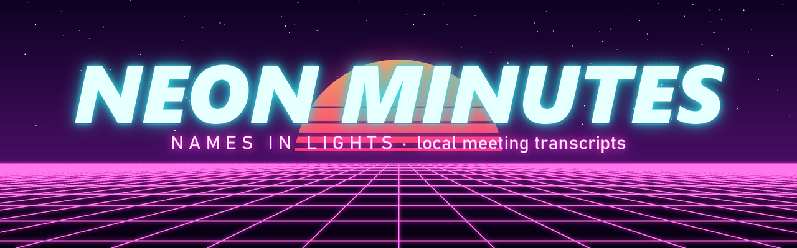
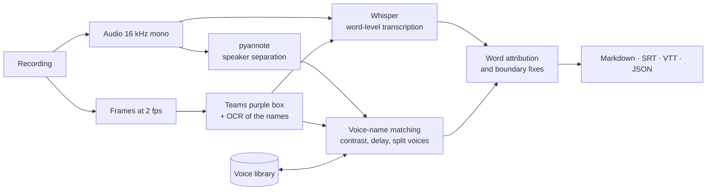

<p align="center">
  
</p>

<h1 align="center"> NEON MINUTES</h1>

<p align="center">
  <em>ｎａｍｅｓ　ｉｎ　ｌｉｇｈｔｓ</em> — meeting transcripts with the name of whoever is speaking, entirely on your own PC.<br>
  <sub>Formerly <em>Neon Verbale</em> (1.2.0–1.4.0) and <em>Trascrittore riunioni</em> (up to 1.1.0).</sub><br>
  <a href="https://github.com/battles5/neon-minutes/releases/latest"><strong>Download for Windows or Linux</strong></a>
  ·
  <a href="docs/Guide.html">User guide</a>
  ·
  <a href="CHANGELOG.md">Changelog</a>
</p>

<p align="center">
  
  
  
  
  
  
</p>

---

Take the recording of a meeting (for example the `.mp4` downloaded from Microsoft Teams) and get
a transcript split by speaker turn, with each participant's name whenever the video shows it.
No account, no cloud service: audio, video and transcripts never leave your computer.

```
**[00:01:10] Giulia Bianchi:** In realtà sì, dopo che abbiamo i due dataset si va al fine-tuning e dovremmo esserci.

**[00:01:25] Mario Rossi:** Lascia stare che in questi giorni non ci ho lavorato, però...
```

> The window speaks English, Italian, Spanish, French, Portuguese and Chinese, and meetings can be
> transcribed in any of those languages or with automatic language detection. The installers and
> the output files (`Trascrizioni` folder, `trascrizione.md`) are in Italian.

## Why "neon"?

- **Words written in light.** A neon sign is a word drawn with light. Neon Minutes does the same with
  what people say in a meeting: spoken words become text you can see, search and keep.
- **Names in lights.** Teams lights up the name of whoever is talking with a glowing purple box.
  That glow is how the program knows who said what: it reads the names while they are lit.
- **Inert by design.** Neon is a noble gas: it reacts with nothing and stays where it is. So do your
  recordings, transcripts and voiceprints: everything is processed on your PC, nothing goes online.

## Features

- **Transcription** with [Whisper](https://github.com/openai/whisper) large-v3 through
  [faster-whisper](https://github.com/SYSTRAN/faster-whisper).
- **Speaker separation** (diarization) with
  [pyannote community-1](https://huggingface.co/pyannote/speaker-diarization-community-1).
- **Names from the Teams video**: Teams highlights the name of whoever is talking with a purple
  box. The program reads those names with OCR and matches them to the voices statistically:
  - a contrast measure that is not fooled by always-open microphones or by the label of whoever
    is sharing the screen;
  - an estimate of the delay with which Teams lights up the highlight;
  - a second pass for people that pyannote splits into two voices.
- **Voice library**: people recognised in one meeting are recognised in the next ones too, even
  without video.
- **One-second corrections**: change a name in `speakers.json` and the transcript is regenerated
  without redoing the heavy work. The correction also improves the voice library.
- **Glossary** of technical terms, acronyms and project names to spell correctly. Participant
  names read from the video are added automatically.
- **Outputs**: readable Markdown, SRT and WebVTT subtitles, word-level JSON with timestamps.
- **Simple window with a queue**: add videos whenever you like, even while one is being
  processed, or drop them on the icon. Start the whole queue or a single video. Every video has its
  own progress bar and estimated time left (ETA), plus a total ETA for everything still to do,
  updated at every addition. Estimates improve with use. Light or dark theme, like the system.
  A command line is there for power users.
- **Languages**: the window in English, Italian, Spanish, French, Portuguese or Chinese, switched
  from a menu at any time. A second menu sets the meeting language (the same six, or automatic
  detection), and each video in the list can have its own.
- **Adapts to the hardware**: uses an NVIDIA GPU when there is one, and the lighter
  large-v3-turbo model on the CPU.
- **Installers for Windows and Linux** with a wizard, no administrator rights, clean uninstall.
  The Linux one is built and tested by GitHub Actions for every release.

## Minimum requirements

|  | Fast mode (GPU) | CPU mode |
|---|---|---|
| System | Windows 10/11 64-bit, Linux x86_64 (glibc 2.28+) | Windows 10/11 64-bit, Linux x86_64 (glibc 2.28+) |
| Graphics card | NVIDIA with at least **4 GB** of VRAM, **Turing or newer** architecture (compute capability 7.5+): GTX 1650 and later, RTX 20xx/30xx/40xx/50xx, Quadro RTX, RTX A-series, RTX Ada | any (Intel, AMD, older NVIDIA) |
| Driver | NVIDIA **570** or later | — |
| RAM | 8 GB (16 GB recommended) | 8 GB (16 GB recommended) |
| Downloaded during installation | about 6 GB (Linux: 7.5 GB) | about 2 GB |
| Disk | about 9 GB, up to 12 GB during installation (Linux: 11 GB, up to 15) | about 3 GB (Linux: 4 GB) |
| Whisper model | large-v3 | large-v3-turbo |
| One hour of meeting | **about 12-15 minutes** | about 1.5 hours on a fast processor, 2-3 hours on an office laptop |

Internet is needed only during installation, to download PyTorch, the libraries and the Whisper
model. The installer checks the graphics card and picks the right build by itself; before it
starts, it shows how much it will download, how much space it needs and how long it will take.
At every start the program chooses GPU or CPU.

## Installation

### Windows

1. Download `NeonMinutes-Setup-<version>.exe` from the
   [Releases](https://github.com/battles5/neon-minutes/releases/latest).
2. Run it. The setup is not digitally signed: if Windows shows "Windows protected your PC",
   choose *More info* → *Run anyway*.
3. Follow the wizard. The **Verifica dell'hardware e spazio necessario** page (*hardware check and
   required space*) tells you what it found, which build it will install, how many GB it will
   download and how much space it needs.
4. The **Installazione dei componenti** page (*installing components*) shows the current step, the
   GB downloaded, the speed and the time left. With a GPU it takes about 15-30 minutes depending on
   the connection (13 minutes measured on a fast line); with the CPU build about 10-15 minutes.

The installation is per user, in `%LOCALAPPDATA%\Programs\Neon Minutes`, with a desktop shortcut
(the neon quill) and a Start menu folder that also holds the guide and *Ripara componenti*
(*repair components*).

**Upgrading from *Neon Verbale* or *Trascrittore riunioni*:** just run the new setup. It moves the
existing installation to the new folder, replaces the shortcuts with the new ones and moves voices,
glossary and downloaded models under the new name: nothing is downloaded again. An icon pinned to
the taskbar keeps working; pin it again if you want it to show the new name. On Linux the `.run`
file does the same with `~/.local/lib/neon-verbale` and the `neon-verbale` command.

### Linux

1. Download `NeonMinutes-<version>-linux-x86_64.run` from the
   [Releases](https://github.com/battles5/neon-minutes/releases/latest).
2. Run it from a terminal, or make it executable and double-click it:
   ```bash
   sh NeonMinutes-<version>-linux-x86_64.run
   ```
3. On a graphical desktop a wizard opens: licence, then the hardware and space check (GPU or CPU
   build, GB to download, space, time), then the progress with the time left. Without a desktop,
   or with `--cli`, the same steps run in the terminal.

No `sudo` and no system packages are needed. The program goes in `~/.local/lib/neon-minutes` and
its data in `~/.local/share/neon-minutes`. The installer adds an entry to the applications menu and
the command `~/.local/bin/neon-minutes`:

| Command | What it does |
|---|---|
| `neon-minutes [video…]` | opens the window, with the given videos already in the list |
| `neon-minutes --trascrivi video.mp4` | transcribes from the terminal (`--trascrivi --help` for the options) |
| `neon-minutes --ripara` | reinstalls PyTorch and the libraries, for example after updating the NVIDIA driver |
| `neon-minutes --disinstalla` | removes the program; asks whether to keep models and voice library |

Installer options: `--cli` (terminal only), `-y` (no questions), `--cpu` (CPU build even with an
NVIDIA GPU), `--no-models` (download Whisper at first use), `--no-desktop` (no desktop shortcut).

## Usage

1. Open **Neon Minutes**.
2. Pick the **Meeting language** (it starts as *Detect automatically*; or Italian, English, Spanish, French, Portuguese, Chinese;
   it also changes the videos already in the list that have not started). The **Interface** menu on the right changes the window's language.
3. Click **Add videos…** and pick one or more recordings (mp4, mkv, mov, avi, webm, or audio only:
   m4a, mp3, wav, ogg). You can add more at any time. Each row shows the video's language
   (IT, EN, ...), which you can change until it starts.
4. Click **Start all**, or **▶** on the row of a single video. **✕** removes a video from the
   list. Videos are processed one at a time, in queue order. On Linux the two row buttons read
   **Start** and **Remove**.

Results go to a `Trascrizioni` folder next to the videos:

```
Meeting-20261020.mp4
Trascrizioni\
  Meeting-20261020\
    trascrizione.md     participants, speaking time, turns
    trascrizione.srt    subtitles
    trascrizione.vtt    web subtitles, with the speaker's name
    trascrizione.json   everything, word by word with timestamps
    speakers.json       who is who: can be corrected by hand
    _lavoro\            intermediate results (cache)
```

To **fix a name**, change `"name"` in `speakers.json` and process the video again: only the
`trascrizione.*` files are regenerated. All the details are in the [user guide](docs/Guide.html),
which is also included in the installers.

## How it works



Reading the video runs on the CPU while the GPU separates the voices. The names read from the
video go into Whisper's prompt, so it spells them correctly. Every step saves its own result in
`_lavoro\`: processing a video again only redoes what is missing.

## Limitations

- **Names are read only from Teams recordings**, which show the purple box on the speaker's name.
  Screen captures of the live Teams client signal the speaker differently, and Zoom and Meet are
  not supported. In those cases the voices are still separated, and names come from the voice
  library or from manual correction.
- **People sharing one microphone** (a meeting room, for example) cannot be told apart by the
  video, only by their voices.
- **Overlapping speech** is attributed to one person at a time.
- **Technical terms** may be transcribed wrongly until you add them to the glossary.
- **Without an NVIDIA GPU it is slow**: about 1.5 times the meeting length on a fast processor.
- **Installers for Windows 10/11 64-bit and Linux x86_64** (glibc 2.28 or later: Ubuntu 20.04+,
  Debian 10+, Fedora 29+ and similar). No macOS. On Linux the program is tested automatically at
  every release (Ubuntu 24.04, CPU mode, on GitHub Actions); GPU mode on Linux has not been tested
  on a real card yet.
- **Tuned for Italian** and tested on Teams recordings of 13 and 26 minutes. The other meeting
  languages have been tested on short synthetic clips only.
- **Chinese interface on Windows only**: on Linux the bundled Tk draws with X core fonts, which have
  no Chinese characters (Chinese meetings can still be transcribed there).
- **The Windows setup is not digitally signed**, so Windows SmartScreen asks for confirmation.
- Recording a meeting and keeping the participants' voiceprints requires their consent:
  voiceprints are personal data (GDPR). The program stores them only on your PC.

## Measured performance

On a laptop with an NVIDIA RTX 2000 Ada (8 GB) and an Intel Core i7-14700HX:

| Recording | Length | GPU | Details |
|---|---|---|---|
| Stand-up | 13:17 | 2:25 | |
| Stand-up | 25:39 | 5:52 | voices 1:18 and names 2:01 in parallel, transcription 3:50 |

In CPU mode, on the same processor, Whisper large-v3-turbo takes about 0.8 times the audio length
and speaker separation about 0.65 times.

## Data and privacy

| What | Windows | Linux |
|---|---|---|
| Program | `%LOCALAPPDATA%\Programs\Neon Minutes` | `~/.local/lib/neon-minutes` |
| Voice library, glossary, timings, logs | `%LOCALAPPDATA%\Neon Minutes` | `~/.local/share/neon-minutes` |
| Downloaded Whisper models | `…\Neon Minutes\modelli` | `~/.local/share/neon-minutes/modelli` |
| Transcripts | `Trascrizioni` folder next to each video | same |

The program connects to the Internet only to download its components. When uninstalling you can
choose whether to delete the models and the voice library too.

## Development

Python 3.12 on Windows (the code also runs on Linux).

```powershell
py -3.12 -m venv .venv
.venv\Scripts\python -m pip install torch torchaudio --index-url https://download.pytorch.org/whl/cu128
.venv\Scripts\python -m pip install -r requirements.txt
copy .env.example .env    # Hugging Face "read" token, to download the pyannote model
.venv\Scripts\python -m meeting_transcriber             # window
.venv\Scripts\python -m meeting_transcriber video.mp4   # command line (--help for the options)
```

In development the pyannote model is downloaded from Hugging Face, after accepting its conditions
on the [model page](https://huggingface.co/pyannote/speaker-diarization-community-1). The
installers include it instead (CC BY 4.0 licence), so users need no token.

**Building the Windows setup** (needs [Inno Setup 6](https://jrsoftware.org/isinfo.php):
`winget install JRSoftware.InnoSetup --scope user`):

```powershell
powershell -ExecutionPolicy Bypass -File installer\build_installer.ps1
```

The script:

1. downloads a portable Python ([python-build-standalone](https://github.com/astral-sh/python-build-standalone))
   and checks its SHA-256;
2. isolates it with a `._pth` file, so a Python already on the user's PC cannot interfere;
3. copies the program, the guide and the pyannote model;
4. pins the exact dependency versions from the `.venv` (`requirements-lock.txt`);
5. writes the third-party notices and compiles `dist\NeonMinutes-Setup-<version>.exe`.

PyTorch (CUDA or CPU build) and Whisper are downloaded on the user's PC during installation, by
`installer\postinstall.py`.

**The Linux installer** is built by GitHub Actions ([`.github/workflows/linux.yml`](.github/workflows/linux.yml))
for every `v*` tag, or by hand from the *Actions* tab. The workflow:

1. creates an environment with the versions tested on Windows (`installer/constraints.txt`);
2. takes the pyannote model from the [`modelli-1`](https://github.com/battles5/neon-minutes/releases/tag/modelli-1)
   release, so CI needs no token;
3. assembles the self-extracting `.run` with `installer/build_linux.sh`: portable Python, program,
   model, guide, plus the `installer/linux_setup.py` wizard;
4. tests it on an empty home: installation, transcription of a synthesised sentence, the window and
   the wizard on a virtual display, uninstallation;
5. attaches it to the tag's release.

```
meeting_transcriber/
  gui.py            Tkinter window, queue, progress bars and ETAs
  i18n.py           texts of the window in six languages, saved language choices
  theme.py          light/dark theme following the system
  cli.py            command line
  pipeline.py       steps, cache, progress, time estimates
  video_labels.py   Teams purple box + OCR (RapidOCR)
  diarize.py        pyannote
  asr.py            faster-whisper
  naming.py         voice-name matching
  voices.py         voice library
  render.py         words → turns, Markdown/SRT/VTT/JSON
  hardware.py       GPU/CPU choice
  paths.py          program and data folders
installer/          Inno Setup (Windows) and Tk (Linux) wizards, post-install, builds
docs/Guide.html     user guide (included in the installers)
assets/             icon, banner and wizard images, with the scripts that draw them
```

## License

**[MIT No Attribution (MIT-0)](LICENSE.txt)**: you can use, copy, modify and redistribute this
software for any purpose, commercial included, with no obligations, not even crediting the author.
It is one of the most permissive OSI-approved open-source licences and, unlike a public-domain
dedication, it also works in countries where authors cannot waive their copyright, such as Italy.

Third-party components keep their own licences. The main ones:

| Component | Licence |
|---|---|
| Whisper (OpenAI models), faster-whisper, CTranslate2 | MIT |
| pyannote.audio | MIT |
| pyannote speaker-diarization-community-1 (included in the installers, unmodified) | CC BY 4.0, © pyannoteAI |
| PyTorch | BSD-3-Clause |
| RapidOCR, OpenCV, ONNX Runtime | Apache-2.0 / Apache-2.0 / MIT |
| PyAV (with FFmpeg) | BSD-3-Clause (FFmpeg: LGPL) |
| sv-ttk, darkdetect | MIT, BSD-3-Clause |
| Python (python-build-standalone) | PSF-2.0 |

The full list, version by version, is generated at every build in `THIRD-PARTY-NOTICES.txt` and
installed with the program.

## Authors

Created by **Orso Peruzzi** ([@battles5](https://github.com/battles5)) and developed together with
**Claude** (Anthropic), who contributed to the design, code, installers and documentation.

Bug reports and ideas are welcome in the [issues](https://github.com/battles5/neon-minutes/issues).
