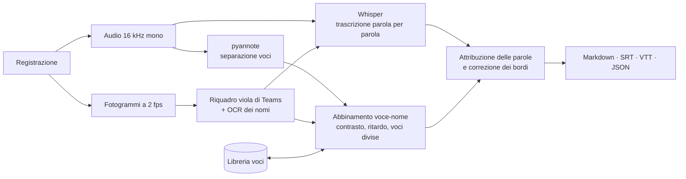

<p align="center">
  
</p>

<h1 align="center">Trascrittore riunioni</h1>

<p align="center">
  Trascrizione delle riunioni con i nomi di chi parla, tutta sul tuo PC.<br>
  <a href="https://github.com/battles5/trascrittore-riunioni/releases/latest"><strong>Scarica il setup per Windows</strong></a>
  ·
  <a href="docs/Guida.html">Guida completa</a>
  ·
  <a href="CHANGELOG.md">Novità</a>
  ·
  <a href="#in-english">English</a>
</p>

<p align="center">
  
  
  
  
</p>

---

Prendi la registrazione di una riunione (per esempio il file `.mp4` scaricato da Teams) e ottieni
la trascrizione divisa per interventi, con il nome di ogni partecipante quando il video lo mostra.
Nessun account, nessun servizio cloud: audio, video e trascrizioni non lasciano il computer.

```
**[00:01:10] Giulia Bianchi:** In realtà sì, dopo che abbiamo i due dataset si va al fine-tuning e dovremmo esserci.

**[00:01:25] Mario Rossi:** Lascia stare che in questi giorni non ci ho lavorato, però...
```

## Funzionalità

- **Trascrizione** con [Whisper](https://github.com/openai/whisper) large-v3 tramite
  [faster-whisper](https://github.com/SYSTRAN/faster-whisper): in italiano di default, in altre
  lingue con `--language`.
- **Separazione dei partecipanti** con
  [pyannote community-1](https://huggingface.co/pyannote/speaker-diarization-community-1).
- **Nomi dal video di Teams**: Teams evidenzia in viola il nome di chi sta parlando. Il programma
  legge quei nomi con l'OCR e li abbina alle voci con criteri statistici:
  - un contrasto che non si lascia ingannare da microfoni sempre aperti o dall'etichetta di chi
    condivide lo schermo;
  - la stima del ritardo con cui Teams accende l'evidenziazione;
  - un secondo passaggio per le persone che pyannote divide in due voci.
- **Libreria delle voci**: le persone riconosciute in una riunione vengono riconosciute anche
  nelle successive, perfino senza video.
- **Correzione in un secondo**: cambi un nome in `speakers.json` e la trascrizione si rigenera
  senza rifare il lavoro pesante. La correzione migliora anche la libreria delle voci.
- **Glossario** di termini tecnici, sigle e nomi di progetti da scrivere giusti. I nomi dei
  partecipanti letti dal video si aggiungono da soli.
- **Formati di uscita**: Markdown da leggere, sottotitoli SRT e WebVTT, JSON parola per parola
  con i tempi.
- **Interfaccia grafica semplice**: scegli uno o più video, oppure trascinali sull'icona. Per
  ogni file c'è una barra di avanzamento con il tempo stimato (ETA), più una barra totale. Le
  stime migliorano con l'uso. C'è anche la riga di comando per gli utenti esperti.
- **Si adatta all'hardware**: usa la GPU NVIDIA quando c'è e il modello più leggero
  large-v3-turbo sulla CPU.
- **Installer Windows** con wizard in italiano, senza diritti di amministratore, con
  disinstallazione pulita.

## Requisiti minimi

|  | Modalità veloce (GPU) | Modalità CPU |
|---|---|---|
| Sistema | Windows 10 o 11 a 64 bit | Windows 10 o 11 a 64 bit |
| Scheda video | NVIDIA con almeno **4 GB** di VRAM, architettura **Turing o successiva** (compute capability 7.5+): GTX 1650 e successive, RTX 20xx/30xx/40xx/50xx, Quadro RTX, RTX A-series, RTX Ada | qualsiasi (Intel, AMD, NVIDIA più vecchie) |
| Driver | NVIDIA **570** o successivo | — |
| RAM | 8 GB (consigliati 16 GB) | 8 GB (consigliati 16 GB) |
| Da scaricare all'installazione | circa 6 GB | circa 2 GB |
| Disco | circa 9 GB (fino a 12 GB durante l'installazione) | circa 3 GB |
| Modello Whisper | large-v3 | large-v3-turbo |
| Un'ora di riunione | **circa 12-15 minuti** | circa 1 ora e mezza su un processore potente, 2-3 ore su un portatile da ufficio |

Serve Internet solo durante l'installazione, per scaricare PyTorch, le librerie e il modello
Whisper. Il programma di installazione controlla la scheda video e sceglie da solo la versione
giusta. Prima di iniziare mostra quanto scaricherà, quanto spazio servirà e quanto tempo ci vorrà.
A ogni avvio il programma sceglie GPU o CPU.

## Installazione

1. Scarica `TrascrittoreRiunioni-Setup-<versione>.exe` dalle
   [Release](https://github.com/battles5/trascrittore-riunioni/releases/latest).
2. Avvialo. Il setup non è firmato digitalmente: se Windows mostra "PC protetto da Windows",
   scegli *Ulteriori informazioni* → *Esegui comunque*.
3. Segui il wizard. La pagina **Verifica dell'hardware e spazio necessario** dice cosa ha
   trovato, quale versione installerà, quanti GB scaricherà e quanto spazio servirà.
4. La pagina **Installazione dei componenti** mostra il passo in corso, i GB scaricati, la
   velocità e il tempo rimanente. Con la GPU ci vogliono circa 15-30 minuti, secondo la
   connessione (13 minuti misurati su una linea veloce); con la CPU circa 10-15 minuti.

L'installazione è per il solo utente, in `%LOCALAPPDATA%\Programs\Trascrittore riunioni`, con il
collegamento sul desktop (la piuma) e la voce nel menu Start, che comprende la guida e
*Ripara componenti*.

## Uso

1. Apri **Trascrittore riunioni**.
2. **Scegli video…** e seleziona una o più registrazioni (mp4, mkv, mov, avi, webm, oppure solo
   audio: m4a, mp3, wav, ogg).
3. **Avvia**.

I risultati vanno in una cartella `Trascrizioni` accanto ai video:

```
Riunione-20261020.mp4
Trascrizioni\
  Riunione-20261020\
    trascrizione.md     partecipanti, tempo di parola, interventi
    trascrizione.srt    sottotitoli
    trascrizione.vtt    sottotitoli web, con il nome di chi parla
    trascrizione.json   tutto, parola per parola con i tempi
    speakers.json       chi è chi: si può correggere a mano
    _lavoro\            risultati intermedi (cache)
```

Per **correggere un nome** cambia `"name"` in `speakers.json` e rielabora il video: si
rigenerano solo i file `trascrizione.*`. Tutti i dettagli sono nella [guida](docs/Guida.html),
inclusa nell'installer.

## Come funziona



La lettura del video gira sulla CPU in parallelo alla separazione delle voci sulla GPU. I nomi
letti dal video entrano nel prompt di Whisper, che così li scrive correttamente. Ogni passaggio
salva il proprio risultato in `_lavoro\`: una nuova elaborazione rifà solo ciò che manca.

## Limiti

- **I nomi si leggono solo dalle registrazioni di Teams**, che mostrano il riquadro viola sul
  nome di chi parla. Le catture dello schermo del client Teams dal vivo segnalano chi parla in un
  altro modo, e Zoom e Meet non sono supportati. In questi casi le voci vengono comunque
  separate, e i nomi arrivano dalla libreria delle voci o dalla correzione manuale.
- **Le persone che parlano dallo stesso microfono** (per esempio una sala riunioni) non si
  distinguono dal video, ma solo dalla voce.
- **Il parlato sovrapposto** viene attribuito a una sola persona alla volta.
- **I termini tecnici** possono essere trascritti male finché non li aggiungi al glossario.
- **Senza GPU NVIDIA è lento**: circa una volta e mezza la durata della riunione su un
  processore potente.
- **L'installer è solo per Windows 10/11 a 64 bit.** Il codice Python è portabile, ma è stato
  provato solo su Windows.
- **È tarato sull'italiano** e provato su registrazioni Teams di 13 e 26 minuti. Le altre
  lingue funzionano con `--language`, ma non sono state verificate.
- **Il setup non è firmato digitalmente**, quindi Windows SmartScreen chiede una conferma.
- Registrare una riunione e conservare le impronte vocali dei partecipanti richiede il loro
  consenso: le impronte sono dati personali (GDPR). Il programma le salva solo sul tuo PC.

## Prestazioni misurate

Su un portatile con NVIDIA RTX 2000 Ada (8 GB) e Intel Core i7-14700HX:

| Registrazione | Durata | GPU | Dettaglio |
|---|---|---|---|
| Stand-up | 13:17 | 2:25 | |
| Stand-up | 25:39 | 5:52 | voci 1:18 e nomi 2:01 in parallelo, trascrizione 3:50 |

In modalità CPU, sullo stesso processore, Whisper large-v3-turbo impiega circa 0,8 volte la
durata dell'audio e la separazione delle voci circa 0,65 volte.

## Dati e privacy

| Cosa | Dove |
|---|---|
| Programma | `%LOCALAPPDATA%\Programs\Trascrittore riunioni` |
| Libreria voci, glossario, tempi, log | `%LOCALAPPDATA%\Trascrittore riunioni` |
| Modelli Whisper scaricati | `%LOCALAPPDATA%\Trascrittore riunioni\modelli` |
| Trascrizioni | cartella `Trascrizioni` accanto a ogni video |

Il programma si collega a Internet solo per scaricare i componenti. Alla disinstallazione puoi
scegliere se cancellare anche modelli e libreria delle voci.

## Sviluppo

Serve Python 3.12 su Windows.

```powershell
py -3.12 -m venv .venv
.venv\Scripts\python -m pip install torch torchaudio --index-url https://download.pytorch.org/whl/cu128
.venv\Scripts\python -m pip install -r requirements.txt
copy .env.example .env    # token Hugging Face "read" per scaricare il modello pyannote
.venv\Scripts\python -m meeting_transcriber             # interfaccia grafica
.venv\Scripts\python -m meeting_transcriber video.mp4   # riga di comando (--help per le opzioni)
```

In sviluppo il modello pyannote si scarica da Hugging Face, dopo averne accettato le condizioni
sulla [pagina del modello](https://huggingface.co/pyannote/speaker-diarization-community-1).
L'installer invece lo include, con licenza CC BY 4.0, così agli utenti non serve il token.

**Costruire il setup** (serve [Inno Setup 6](https://jrsoftware.org/isinfo.php):
`winget install JRSoftware.InnoSetup --scope user`):

```powershell
powershell -ExecutionPolicy Bypass -File installer\build_installer.ps1
```

Lo script:

1. scarica un Python portatile ([python-build-standalone](https://github.com/astral-sh/python-build-standalone))
   e ne verifica lo SHA-256;
2. lo isola con un file `._pth`, così un Python già presente sul PC dell'utente non interferisce;
3. copia il programma, la guida e il modello pyannote;
4. fissa le versioni esatte delle dipendenze dal `.venv` (`requirements-lock.txt`);
5. genera gli avvisi di terze parti e compila `dist\TrascrittoreRiunioni-Setup-<versione>.exe`.

PyTorch, nella versione CUDA o CPU, e Whisper vengono scaricati sul PC dell'utente durante
l'installazione, da `installer\postinstall.py`.

```
meeting_transcriber/
  gui.py            interfaccia Tkinter, barre e ETA
  cli.py            riga di comando
  pipeline.py       passaggi, cache, avanzamento, stime dei tempi
  video_labels.py   riquadro viola di Teams + OCR (RapidOCR)
  diarize.py        pyannote
  asr.py            faster-whisper
  naming.py         abbinamento voce-nome
  voices.py         libreria delle voci
  render.py         parole → interventi, Markdown/SRT/VTT/JSON
  hardware.py       scelta GPU/CPU
  paths.py          cartelle del programma e dei dati
installer/          wizard Inno Setup, post-installazione, build
docs/Guida.html     guida per gli utenti (inclusa nell'installer)
```

## Licenza

**[MIT No Attribution (MIT-0)](LICENSE.txt)**: puoi usare, copiare, modificare e ridistribuire
questo software per qualunque scopo, anche commerciale, senza obblighi, nemmeno quello di citare
l'autore. È tra le licenze open source più permissive approvate dalla OSI e, a differenza di una
dichiarazione di pubblico dominio, vale anche nei paesi in cui non si può rinunciare al diritto
d'autore, come l'Italia.

I componenti di terze parti mantengono le proprie licenze. I principali:

| Componente | Licenza |
|---|---|
| Whisper (modelli OpenAI), faster-whisper, CTranslate2 | MIT |
| pyannote.audio | MIT |
| pyannote speaker-diarization-community-1 (incluso nell'installer, senza modifiche) | CC BY 4.0, © pyannoteAI |
| PyTorch | BSD-3-Clause |
| RapidOCR, OpenCV, ONNX Runtime | Apache-2.0 / Apache-2.0 / MIT |
| PyAV (con FFmpeg) | BSD-3-Clause (FFmpeg: LGPL) |
| Python (python-build-standalone) | PSF-2.0 |

L'elenco completo, versione per versione, viene generato a ogni build in `THIRD-PARTY-NOTICES.txt`
e installato con il programma.

## Autori

Ideato da **Orso Peruzzi** ([@battles5](https://github.com/battles5)) e sviluppato insieme a
**Claude** (Anthropic), che ha contribuito a progettazione, codice, installer e documentazione.

Segnalazioni e proposte sono benvenute nelle [issue](https://github.com/battles5/trascrittore-riunioni/issues).

---

## In English

**Trascrittore riunioni** ("meeting transcriber") turns a meeting recording into a transcript split
by speaker, with real names when the video is a Microsoft Teams recording. Teams highlights the
active speaker's name in purple; the app reads those labels with OCR and matches them to the voice
clusters found by pyannote. Everything runs locally: faster-whisper (large-v3 on NVIDIA GPUs,
large-v3-turbo on CPU), pyannote community-1, RapidOCR.

- Outputs Markdown, SRT, WebVTT and word-level JSON. Names can be fixed in `speakers.json` and
  regenerated in a second. A local voice library recognises people across meetings.
- Simple Tkinter GUI with per-file and overall progress bars and ETAs, plus a CLI.
- Windows installer: per-user, no admin rights. It detects the GPU and installs the CUDA or CPU
  build of PyTorch.
- GPU mode needs an NVIDIA GPU with compute capability ≥ 7.5, ≥ 4 GB VRAM and driver ≥ 570. One
  hour of meeting takes about 12-15 minutes on an RTX 2000 Ada. CPU mode works anywhere but takes
  about 1.5× the recording length on a fast CPU.
- The UI and documentation are in Italian. Transcription defaults to Italian; use `--language`
  for other languages.

License: [MIT-0](LICENSE.txt). Third-party components keep their own licenses (see above).
